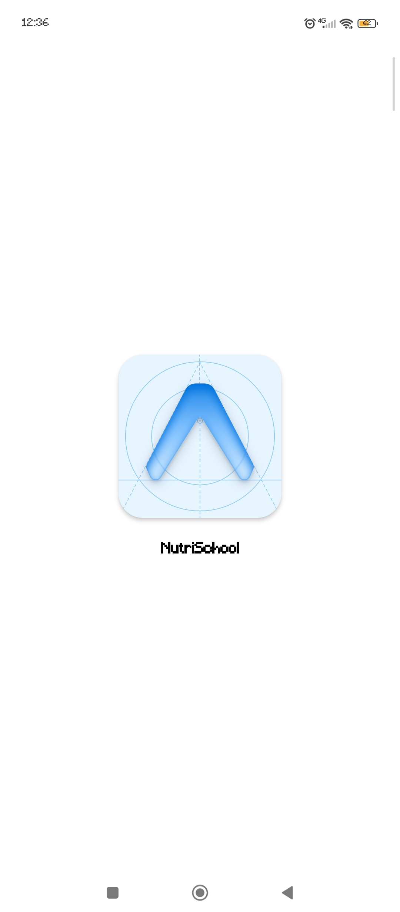
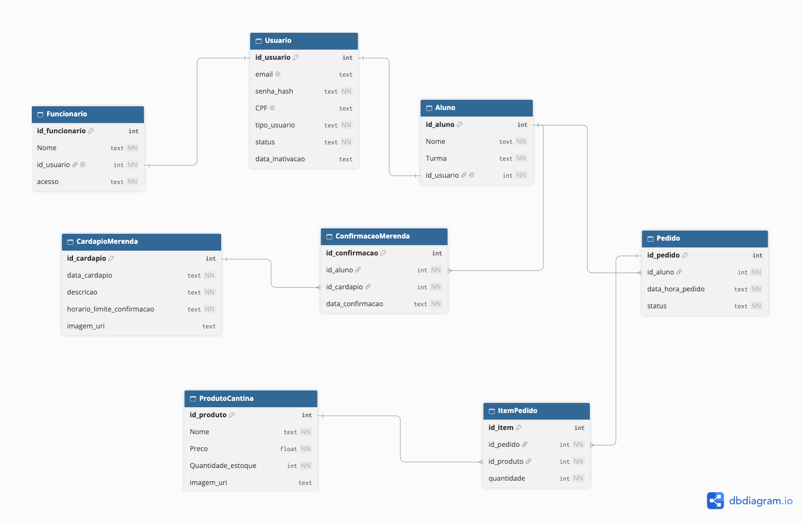

- **Dev-Mobile:Gustavo pereira Silva**

## Tecnologias utilizadas
- **React Native:** desenvolvimento do aplicativo mobile.
- **Expo SDK 56:** ambiente e ferramentas de desenvolvimento.
- **Expo Go:** execução e visualização do projeto em dispositivo móvel.
- **Expo SQLite:** banco de dados local.
- **JavaScript:** linguagem de programação.
- **Node.js:** ambiente necessário para executar as ferramentas de desenvolvimento.

## Como executar o projeto

### Pré-requisitos
- Node.js (versão LTS).
- Expo Go instalado no celular.
- Git instalado no computador.

### 1. Clonar o repositório
```bash
git clone https://github.com/Gusta-pera69/Nutrischool.git
```

### 2. Entrar na pasta do projeto
```bash
cd Nutrischool
```

### 3. Instalar as dependências
```bash
npm install
```

### 4. Iniciar o aplicativo
```bash
npx expo start
```

### 5. Abrir no celular

- Abra o Expo Go.
- Leia o QR Code exibido no terminal ou navegador.
- Aguarde o aplicativo carregar.

**Observações:**
- O computador e o celular devem estar conectados à mesma rede Wi-Fi.
- Caso a rede apresente problemas de conexão, execute `npx expo start --tunnel`.
- O projeto utiliza Expo SDK 56. Confira a compatibilidade do Expo Go antes de executar.


## Minha contribuição
- Preparação do ambiente de desenvolvimento mobile.
- Utilização do React Native e Expo.
- Instalação e preparação da biblioteca `expo-sqlite` para integração com o banco de dados local. para integração com o SQLite

### Evidências

| Item | Evidência |
|---|---|
| Repositório no GitHub | [Nutrischool](https://github.com/Gusta-pera69/Nutrischool) |
| Projeto Expo SDK 56 | Print do projeto executando no Expo Go |
| Biblioteca `expo-sqlite` | Registro no `package.json` |
| Primeiro commit | Histórico de commits do GitHub |

- **Dev-Dados:Gustavo pereira Silva**
## Banco de dados

O banco de dados do NutriSchool utiliza um modelo relacional composto por 8 tabelas, responsáveis por organizar as informações dos usuários, alunos, funcionários, merenda, produtos e pedidos.

### Diagrama Entidade-Relacionamento (DER)



### Script SQL

O arquivo [`script-banco.sql`](docs/scripit-banco.sql) contém a estrutura e as instruções SQL do banco de dados.

O script utiliza `PRAGMA foreign_keys = ON` para habilitar a verificação das chaves estrangeiras no SQLite.

Teste o script completo no [SQLite Online](https://sqliteonline.com).

### Estrutura do banco

| Tabela | Finalidade |
|---|---|
| `Usuario` | Armazenar os dados de acesso das contas. |
| `Aluno` | Registrar os dados dos alunos. |
| `Funcionario` | Registrar os dados dos funcionários e seus acessos. |
| `CardapioMerenda` | Armazenar as informações dos cardápios. |
| `ConfirmacaoMerenda` | Registrar as confirmações de participação na merenda. |
| `Pedido` | Armazenar os pedidos realizados pelos alunos. |
| `ProdutoCantina` | Registrar os produtos, preços e informações de estoque. |
| `ItemPedido` | Relacionar os produtos aos respectivos pedidos. |

### Integridade e regras de exclusão

O banco utiliza chaves primárias (`PRIMARY KEY`) e estrangeiras (`FOREIGN KEY`) para identificar os registros e manter os relacionamentos entre as tabelas.

As regras de exclusão foram definidas para preservar o histórico e evitar a perda de informações importantes:

- **RESTRICT:** impede a exclusão de registros que possuem vínculos com outros dados, preservando o histórico de compras, confirmações de merenda e registros relacionados aos alunos, funcionários e produtos.
- **CASCADE:** permite que os itens de um pedido sejam excluídos automaticamente quando o próprio pedido for excluído.

### Inativação de contas

A tabela `Usuario` possui os campos `status` e `data_inativacao`, permitindo registrar a situação da conta e a data em que ela foi inativada.

A proposta é preservar os registros históricos durante um período de inatividade. Após o prazo definido, o aplicativo poderá executar uma rotina administrativa para anonimizar ou excluir os dados pessoais elegíveis, mantendo as informações necessárias para consultas e prestação de contas.

### Operações e consultas (CRUD)

O planejamento das operações do banco contempla:

- **CREATE (INSERT):** cadastro de informações.
- **READ (SELECT):** consulta e visualização de dados.
- **UPDATE:** atualização de registros.
- **DELETE:** exclusão de registros.
- Consultas com `JOIN` para relacionar informações de diferentes tabelas.
- Agrupamentos e contagens utilizando `GROUP BY`.

## Minha contribuição
- Elaboração do Diagrama Entidade-Relacionamento (DER).
- Desenvolvimento do dicionário de dados.
- Criação e validação do script SQL.
- Definição das tabelas, atributos e relacionamentos.
- Definição das regras de integridade referencial (`RESTRICT` e `CASCADE`).
- Planejamento das operações CRUD e consultas do banco.